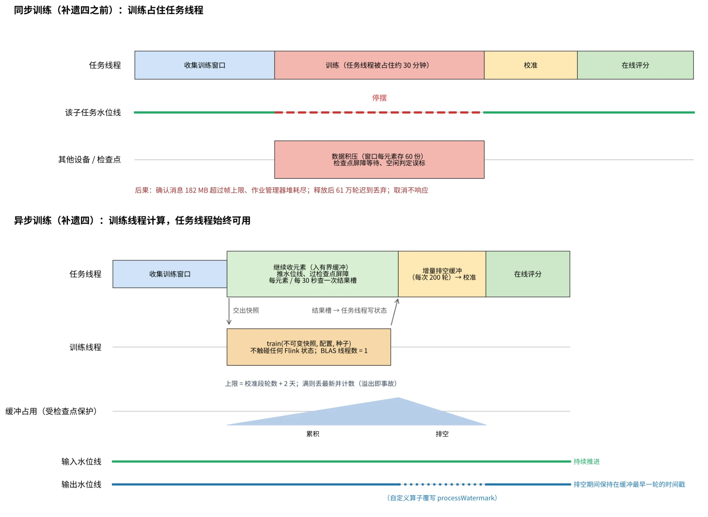

# 交接文档：上下文异常检测模块补遗四——把模型训练移出任务线程
# Handover: M3 Addendum 4 — Training Off the Task Thread

> **发出方**：开发设计会话（开发设计日志 0.82 版；八项设计决定经用户 2026 年 10 月 13 日逐项确认，本文档为正式交付版）
> **接收方**：代码开发 agent
> **前置声明**：遵守项目 `CLAUDE.md` 的全部适用条款（Java 11、Maven、包根 `com.leejean`、中英双语注释、脚本交付五要素）。本补遗是上下文异常检测模块（M3，LSTM 自编码器）收口前的最后一项必交付内容；它不改变模型、阈值、数据分段与任何检测语义，只改变训练在何处执行、训练期间数据如何流动。完成后的全量重放必须与 10 月 9 日的注入运行逐位相同，这是本补遗的核心验收项。
> **术语**：任务线程指 Flink 为每个子任务分配的、负责处理元素、水位线与检查点屏障的那一个线程；训练线程指本补遗新设的、专门执行模型训练的线程；水位线指 Flink 的事件时间进度标记。

---

## 第零节：两点澄清（用户 10 月 13 日提问，答复入档）

**本补遗与重训、与注入数据的关系。** 本补遗不实现重训，也不以注入数据触发任何训练。全量重放里的注入只有两个用途：让八台设备都有可与注入运行逐位比较的对象，以及顺带完成守卫的在线核对。注入模拟的是异常（单台、短暂、回到基线），不是漂移；将来适应执行模块的重训由数据层漂移监测在真实数据的自然漂移上触发，确定性测试用例是三月二十二日至二十七日的环境事件（数据事实第三十条），不用注入去"制造"漂移。

**异常与漂移在本场景中的区别。** 异常是单台设备上短暂出现、随后回到基线的偏离（尖峰、阶跃、短时偏移），检测器应当报出；漂移是分布持续的变化并成为新的正常（季节趋势、散布扩大的日子、持续的水平平移、安装位置的现场条件），检测器对它的告警是对分布变化的响应，应由漂移监测识别、由聚合模块按共模与设备专有区分、由适应执行模块通过重训让检测器适应，而不是让检测器一直报警。真实数据本身带有自然漂移，这是这套数据集的价值所在，按"不迎合"约定作为测试材料与论文证据，不作为要清除的噪声。图示见 `docs/figures/anomaly_vs_drift.png`。

## 第一节：为什么要做，以及做到什么程度

### 1. 同步训练的三起事故与四条实测输入

补遗三允许冷启动训练在任务线程上同步执行，作为验收期的权宜之计，并约定"再出事即停下先做补遗四"。三次长运行各出一起事故，机理相同：训练占住任务线程期间，该子任务不能处理元素、不能推进水位线、不能响应检查点屏障，也不能响应取消。由此得到四条实测输入：

1. 全机队水位线停摆（三月第一次运行）：一台设备训练约三十分钟，未被阻塞的设备把数据积压在轮组装器与点异常通道的滑动窗口里（每个元素存六十份），训练后第一个检查点的确认消息一百八十二兆，超过帧上限，作业管理器堆耗尽退出。
2. 空闲判定误标（三月至四月运行）：十秒空闲时限把被训练阻塞的路径判为空闲，其余设备把水位线推到数据末尾，释放后六十一万五千四百七十四轮全部迟到丢弃。临时对策是空闲时限三千六百秒与两段重放。
3. 取消不响应（三月第一次运行）：训练中的任务不响应取消，一台任务管理器退出；临时对策是训练循环每轮检查中断。
4. 检查点挂起（注入运行）：训练期间挂起的检查点端到端一千六百二十七秒，依赖把超时临时放到一百二十分钟才没有失败。

这四条都是症状，病因只有一个：训练在任务线程上。本补遗治病因，四条临时对策随之撤销（第五节）。

### 2. 做到什么程度

本补遗只做冷启动训练的异步化，并把训练执行器的接口留给适应执行模块（M6）的重训复用。不做：重训逻辑、净化强度参数、漂移触发、告警降权（这些归适应执行模块）；不做任何模型或阈值改动。

---

## 第二节：机制设计

### 1. 总体结构

下图把同步训练与异步训练并排画出（文件 `docs/figures/addendum4_async_training.png`，随本文档一起放入仓库）：



训练仍在上下文异常检测算子所在的任务管理器进程内执行，但在一个专用的训练执行器（固定大小的线程池）上运行；任务线程只负责把训练输入交出去、把训练结果收回来，自身始终可用。示意如下：

```
 事件时间 →   收集态                 训练态（训练线程在算）                 校准态          在线态
            ┌──────────────┬────────────────────────────────────────┬──────────────┬──────────►
 任务线程    │ 收集训练窗口  │ 继续收元素、推水位线、过检查点屏障       │ 排空缓冲→校准  │ 逐轮评分
            │              │ 到达的轮进入有界缓冲（受检查点保护）     │ 再接实时轮    │
            │              │ 每个元素或定时器到来时查一次结果槽       │              │
            └──────┬───────┴──────────────▲─────────────────────────┴──────────────┴──────────►
                   │ 交出不可变训练快照     │ 训练线程把模型放进结果槽
            ┌──────▼──────────────────────┴─────┐
 训练线程    │ 纯函数 train(快照, 配置, 种子)       │   不触碰任何 Flink 状态
            └────────────────────────────────────┘
 输出水位线   ──────────────────┐ 缓冲非空期间保持在缓冲中最早一轮的时间戳 ┌──── 排空后恢复跟随输入
                               └──────────────────────────────────────┘
```

### 2. 训练的提交与结果的收回

第一，当某台设备的收集态结束（训练集与早停集的窗口收齐）时，任务线程把这些窗口**复制成一份不可变快照**（训练线程不得持有任何 Flink 状态对象的引用），连同该设备的训练配置、确定性种子、目的标记（冷启动或重训）组成一个训练任务，提交给训练执行器；设备相位改为"训练态"，把提交时刻与训练任务标识写入受检查点保护的状态。

第二，训练线程调用既有的纯函数训练入口（补遗三要求的 `train`），线程内的 BLAS 线程数固定为一（与离线网格一致，也避免抢占任务线程）。训练完成后把模型权重、早停轮数、早停集误差、训练时长放进一个按设备键索引的并发结果槽（例如 `ConcurrentHashMap<设备, 训练结果>`），不写任何 Flink 状态。

第三，任务线程在每次处理该设备的元素时、以及每隔固定间隔（处理时间定时器，建议三十秒）查一次结果槽；取到结果后在任务线程上把模型写入受检查点保护的状态，设备相位改为"校准态"，开始排空缓冲（第 3 条）。所有对 Flink 状态的读写只发生在任务线程，这是 Flink 状态线程安全的硬约束。

第四，训练失败（异常、中断）时结果槽里放失败记录，任务线程取到后计数、记日志，并按"重新提交一次，仍失败则该设备停在训练态并上报"处理，不无限重试。

### 3. 训练期间到达的轮：有界缓冲与排空

**为什么必须缓冲。** 阈值校准段是训练段之后紧接的七天，由数据决定，不随训练耗时变化；离线与在线等值约定要求在线校准用的正是这七天。如果训练期间到达的轮被丢掉，校准段就会后移训练耗时那么长（重放加速下可能是一天数据），阈值随之不同，与注入运行的逐位相同验收必然失败。因此训练期间到达的轮必须保留。

**缓冲的形态。** 每台设备一个受检查点保护的列表状态（`ListState<轮>`），只存轮向量、掩码与时间戳，不存窗口（窗口在排空时按原顺序重新装配，与同步时代逐轮装配的行为一致）。上限按轮数计：校准段轮数加两天的轮数（按该设备的"每天折合轮数"参数换算，十秒一轮时为六万零四百八十加一万七千二百八十）。缓冲满后不再接纳新轮，丢弃并计数（指标 `m3_train_buffer_overflow`），丢最新而不是丢最旧，以保证校准段从训练段结束处连续；溢出大于零即为事故，上报而不是绕过。

**排空的节奏。** 结果收回后，任务线程不一次性把缓冲全部评完（六万轮乘每轮几十毫秒会把任务线程占住几十分钟，等于把病因换个地方），而是增量排空：每次处理该设备的元素时以及每次定时器触发时，从缓冲头部取固定数量的轮（建议二百轮，参数化）按顺序送入校准或评分逻辑，直到缓冲为空；期间新到的轮继续追加到缓冲尾部，保证顺序。排空速度由推理速度决定，与在线态持续评分的吞吐相同，所以一定能追上。

**输出水位线的保持。** 排空期间算子发出的评分带着比当前输入水位线更早的事件时间戳，若算子照常转发水位线，这些评分对下游（将来的聚合模块的事件时间窗口）就是迟到记录，违反水位线契约。因此上下文异常检测算子要改为自定义算子（继承 `KeyedProcessOperator` 并覆写 `processWatermark`），对外发出的水位线取"输入水位线"与"本子任务所有设备缓冲中最早一轮的时间戳"两者的较小值；缓冲全部排空后恢复跟随输入。代理键已经使每个子任务只承载一台设备，所以这个最小值在实际运行里就是该设备的缓冲头。这是本补遗中唯一一处触及 Flink 算子接口的改动，若实现上有障碍，先上报再定。

### 4. 重启后的处理：从受检查点保护的窗口幂等重启训练

训练线程里的进行中训练不进检查点。作业从检查点恢复时，任务线程在设备的第一个元素或定时器到来时检查相位：相位为训练态且状态里没有模型，就用受检查点保护的收集窗口**重新提交一次训练**；训练是纯函数且种子确定，所以结果与未被打断的训练逐位相同（三月重跑已确立"输入相同则逐位相同"）。缓冲里的轮随检查点恢复，不丢。结果槽是进程内存，恢复后为空，这正是重新提交的条件之一。

### 5. 并发限制

训练执行器的线程数是参数（`--train-threads`），默认每个任务管理器两个线程；超出的训练任务在执行器队列中按提交顺序等待，等待期间设备仍是训练态、缓冲照常累积（缓冲上限的两天余量就是为排队留的）。注入运行实测最多六台同时训练、减速一点六到一点九倍；两个线程的取值是为了给任务线程与推理留出核。实际取值随步骤 C 的测量定（第四节）。

### 6. 取消与关闭

算子 `close()` 时关闭执行器并中断所有训练线程；训练循环已经每轮检查中断，中断后在一轮之内退出。取消作业的端到端时限在步骤 C 实测，要求三十秒之内。

### 7. 留给适应执行模块的接口

训练执行器的提交接口接受一个训练任务对象，字段为：设备、不可变数据快照、训练配置、种子、目的标记（`COLD_START` 或 `RETRAIN`）、一个暂时为空的净化选项对象。重训时适应执行模块只需构造目的为 `RETRAIN` 的任务提交给同一个执行器，结果收回与模型替换走同一条路。净化强度的定义按补遗三的约定仍然留给适应执行模块，本补遗只保证接口上有它的位置。

---

## 第三节：代码改动清单

| 项目 | 内容 |
| --- | --- |
| 训练执行器 | 新类：固定线程池、按设备键的结果槽、提交与查询接口、关闭时中断；BLAS 线程数在训练线程内设为一 |
| 上下文异常检测算子 | 改为自定义算子（覆写 `processWatermark`）；相位机新增"训练态下的元素处理"（入缓冲）与"排空"逻辑；处理时间定时器（结果查询与排空节拍）；重启后的重新提交 |
| 状态 | 新增缓冲列表状态、训练任务标识与提交时刻；模型、阈值统计量、相位仍是既有状态 |
| 参数 | `--train-threads`（默认二）、`--drain-batch`（默认二百）、`--poll-interval-sec`（默认三十）、缓冲上限由"每天折合轮数"推导不单独设参 |
| 指标与快照 | `m3_train_buffer_size`（当前缓冲轮数，逐设备）、`m3_train_buffer_overflow`、`m3_train_queue_wait_sec`、`m3_train_wall_sec`、`m3_watermark_hold_sec`（输出水位线被保持的时长）；监测快照新增逐设备相位与缓冲占用 |
| 测试 | 单元：结果收回只在任务线程、缓冲顺序与上限、丢最新、排空分批、水位线保持取最小值、重启后重新提交（MiniCluster 用检查点恢复）、关闭时中断。等值：同一数据下异步路径与同步路径的训练结果逐位相同、阈值逐位相同 |
| 配置回收 | 见第五节 |

---

## 第四节：验证——步骤 C 短重放预验证，然后全量重放

### 1. 步骤 C（缩小"每天折合轮数"，训练几分钟内触发）

在集群上用短重放做五件事，每件给出数字：

1. 任务线程可用性：训练期间该子任务的检查点端到端时长不超过训练前正常值的两倍；全程零检查点失败。
2. 水位线：训练期间全机队输入水位线持续推进（监测快照中各子任务的水位线滞后不超过空闲时限六十秒）；输出水位线保持的时长等于缓冲排空时长。
3. 取消：在某台设备训练中途取消作业，端到端三十秒内完成。
4. 重启：在某台设备训练中途杀掉承载它的任务管理器，作业从检查点恢复后该设备重新提交训练，最终模型权重与未被打断的一次运行逐位相同；缓冲内容无丢失（对账缓冲轮数）。
5. 并发：线程数取一、二、四各跑一次，记录逐台训练时长与任务线程的检查点时长，据此定 `--train-threads` 的默认值。

### 2. 全量重放（本来就必须进行的运行，按确认性运行约定承载正式数字）

**运行定义：注入运行的完全重复**——三月一日至四月三十日，设备 E 按 `docs/m3_inject_plan.csv` 注入（同一方案、同一时刻），其余七台不注入；单段重放（不再两段）；生产配置（第五节）；守卫阈值表写入配置。选择重复注入运行而不是无注入运行，是为了让八台设备都有可逐位比较的对象，并顺带完成守卫的在线核对。

**验收项（全部必过）：**

- A4-1 重放完整性七条断言全部通过；迟到丢弃为零；零重启；零检查点失败；检查点端到端时长在训练期间不超过正常值两倍。
- A4-2 **逐位等值**：八台设备的训练早停轮数、早停集误差、阈值统计量与注入运行完全相同；八台设备的全部上下文评分逐窗与注入运行相同（主分到小数点后九位，与此前的确定性核对口径一致）；点通道输出与注入运行相同。任何一处不同都是缺陷，上报而不是解释。
- A4-3 缓冲溢出为零；报告逐台缓冲峰值、排空时长、输出水位线保持时长。
- A4-4 守卫在线核对：三次温度卡死注入在阈值长度处打标；自然数据零触阈（守卫收口裁决第三节）。
- A4-5 性能：逐台训练时长（含排队等待）、训练期间任务管理器内存峰值（新配置五千一百二十兆下）、推理时延分布，与注入运行并排。

---

## 第五节：撤销临时对策，恢复生产取值

本补遗部署时一并生效：

| 项目 | 验收期临时值 | 恢复后的生产值 | 依据 |
| --- | --- | --- | --- |
| 空闲时限 `--idle-wall` | 三千六百秒 | 六十秒（重放中按倍速换算，写入运行手册） | 10 月 5 日裁决：须长于路径可能被阻塞的最长时间；异步化后阻塞回到毫秒级 |
| 检查点超时 | 一百二十分钟 | 十分钟（Flink 默认） | 训练不再占住屏障 |
| 检查点间隔与容忍失败 | 三十秒、三次 | 不变 | — |
| 重放方式 | 两段 | 单段 | 水位线不再停摆 |
| 训练循环中断检查 | 保留 | 保留 | 取消响应仍需要它 |
| 任务管理器进程总量与 JavaCPP 物理上限 | 四千零九十六兆、三千九百兆 | 五千一百二十兆、五千一百二十兆 | 10 月 9 日裁决，在本次重建任务管理器容器时执行；重建前 `syn-tm-recreate.sh --check-only` 核实工作节点余量 |
| 代理键一对一放置 | 启用 | 保留 | 它同时服务于输出水位线保持 |

---

## 第六节：报告

`docs/reports/m3_addendum4_report.md`（中文）：步骤 C 五件事的数字与线程数定值；全量重放的七条断言输出；A4-1 至 A4-5 逐项结果，其中逐位等值给出逐台对照表；缓冲与水位线指标的时间曲线图；撤销临时对策后的配置清单；与本文档不符的任何实测，单列一节如实上报。

## 第七节：边界

不改模型、阈值、数据分段、学习率、净化口径；不实现重训、漂移触发或告警降权；不改数据接入与点异常通道（守卫配置写入除外）。任何与本文档冲突的实测或实现障碍，一律上报，不自行变通。本补遗完成并通过第四节验收后，上下文异常检测模块收口。
